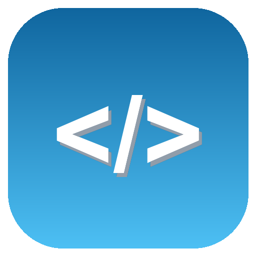

<div align="center">



# Novaus IDE

Lightweight desktop IDE with built-in bytecode decompilation and autonomous AI agent.

[](https://github.com/aunixboss-spec/Novaus-IDE/releases)
[](LICENSE)
[]()
[]()

<br><br>


</div>

## Overview

**Novaus IDE** is a minimal, fast development environment designed around Monaco Editor. It couples everyday code authoring and execution with an embedded reverse-engineering pipeline, enabling instant disassembly and decompilation of `.wasm`, `.class`, `.pyc`, and `.NET` binaries straight from the workspace.

## Features

* **Monaco Editor** — Multi-tab editing powered by VS Code's editor engine, featuring syntax highlighting across 25+ languages, change markers, and custom file icons.
* **Integrated Decompiler Suite** — Direct binary inspection without external tools:
  * **WebAssembly (`.wasm`)** — Disassembles to WAT via bundled WABT (works offline, zero setup).
  * **JVM (`.class`)** — Java bytecode decompilation via JDK `javap` or CFR.
  * **Python (`.pyc`, `.pyo`)** — Disassembles bytecode via Python's built-in `dis` module.
  * **.NET (`.dll`, `.exe`)** — C# and IL inspection via `ilspycmd`.
* **Autonomous AI Copilot** — Connects to any OpenAI-compatible API endpoint (Groq, OpenRouter, OpenAI):
  * **Agent Mode** — Grants the assistant permission to read/write project files and execute terminal tasks.
  * **Model Auto-Discovery** — Instant key check with automated model fetching from your endpoint.
  * **Code Insertion** — One-click insertion of code snippets directly into your current buffer.
* **Embedded PowerShell Terminal** — Work directly inside the root workspace folder with command history (`↑` / `↓`).
* **Quick Script Runner (`F5`)** — Instant execution of Python and Node.js files with streamed output panels.
* **Session Persistence** — Automatically restores open project folders, active tabs, terminal input history, and Copilot chats.

## Getting Started

### Prerequisites

* [Node.js](https://nodejs.org/) (v18 or higher)
* [Git](https://git-scm.com/)

### Installation & Launch

```bash
git clone [https://github.com/aunixboss-spec/Novaus-IDE.git](https://github.com/aunixboss-spec/Novaus-IDE.git)
cd Novaus-IDE
npm install
npm start

On Windows, you can also launch the app by double-clicking Запустить IDE.cmd.
Decompiler Setup
.wasm analysis works out of the box with zero configuration. Other formats require their respective CLI runtimes configured in your system PATH:
| Binary Format | Toolchain | System Requirement |
|---|---|---|
| .wasm | WABT | Bundled with the project |
| .class | javap / CFR | JDK in PATH or local cfr.jar |
| .pyc / .pyo | Python dis | Python 3.x in PATH |
| .dll / .exe | ILSpy | dotnet tool install -g ilspycmd |
AI Configuration
 * Toggle the AI Copilot pane (<kbd>Ctrl</kbd> + <kbd>I</kbd>).
 * Click Settings (⚙) and set your custom Base URL (e.g. https://api.groq.com/openai/v1), Model name, and API key.
 * Click Check Key & Load Models to validate the connection.
API keys and parameters are stored strictly locally at %APPDATA%\Novaus IDE\config.json.
Keyboard Shortcuts
| Shortcut | Description |
|---|---|
| <kbd>Ctrl</kbd> + <kbd>S</kbd> | Save current buffer |
| <kbd>F5</kbd> | Run file (Python / Node.js) |
| <kbd>Ctrl</kbd> + <kbd>B</kbd> | Show / hide Project Explorer |
| <kbd>Ctrl</kbd> + <kbd>I</kbd> | Toggle AI Copilot panel |
Project Structure
Novaus-IDE/
├── src/               # Electron main, preload, renderer scripts and stylesheet
│   └── assets/        # Visual assets and application icons
├── demo/              # Demonstration workspace for testing features
├── make-icon.py       # Asset generation utility
└── package.json       # Electron packaging and dependency metadata


