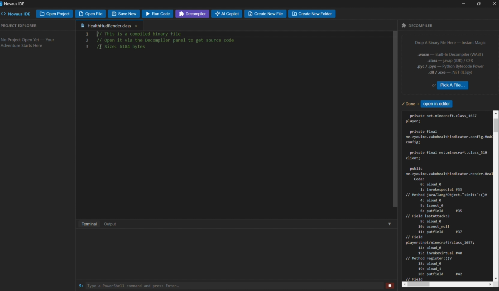
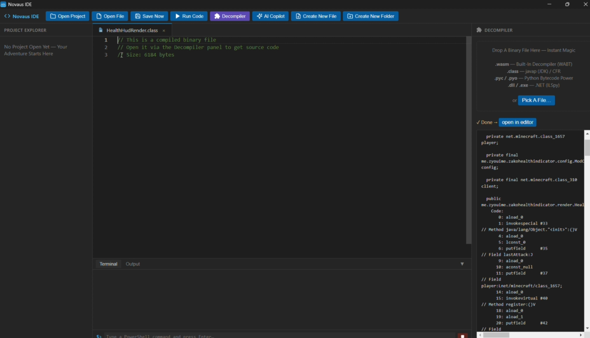

#  Novaus IDE

### *The Ultimate Engineering Experience. Power Your Code. Unleash Your Potential.*

Next-generation desktop IDE blending raw Electron speed, sleek aesthetics, autonomous AI agents, and a dedicated native binary decompiler suite[span_0](start_span)[span_0](end_span)[span_1](start_span)[span_1](end_span).

  

---

##  Overview

**Novaus IDE** isn't just another text editor — it’s a lightweight powerhouse crafted for developers and reverse engineers who refuse to compromise between speed, aesthetics, and pure functionality[span_2](start_span)[span_2](end_span). Built from the ground up around the legendary **Monaco Editor engine**, Novaus delivers instant responsiveness and eliminates the bloat of traditional heavy IDEs[span_3](start_span)[span_3](end_span).

Inspect compiled assemblies, orchestrate self-directed AI agents, stream CLI execution, and reverse-engineer binaries — all within a single, unified, dark-glass interface[span_4](start_span)[span_4](end_span)[span_5](start_span)[span_5](end_span)[span_6](start_span)[span_6](end_span).

---

##  Supported Decompiler Formats

Stop context-switching between third-party decompilers[span_7](start_span)[span_7](end_span)[span_8](start_span)[span_8](end_span). Novaus IDE embeds a high-performance reverse-engineering pipeline directly beside your active code buffer[span_9](start_span)[span_9](end_span):

| Format | Target Platform | Backend Engine | Integration Level |
| :--- | :--- | :--- | :--- |
| **`.wasm`** | WebAssembly | **WABT** (Native) |  **Zero Setup** — Works fully offline out of the box |
| **`.class`** | JVM / Java Bytecode | **javap** / **CFR** |  Native JDK PATH or instant local JAR hook |
| **`.pyc`, `.pyo`** | Python Bytecode | Python **dis** Engine |  Direct disassembly through local Python runtime |
| **`.dll`, `.exe`** | .NET Ecosystem | **ILSpy** (`ilspycmd`) |  High-speed C# / IL reconstruction |

 

  

---

##  Elite Features

*  **Monaco Core** — The unmatched performance of VS Code’s editing engine featuring syntax highlighting across 25+ programming languages, granular change indicators, and bespoke file iconography[span_10](start_span)[span_10](end_span).
*  **Autonomous AI Copilot** — Elevate your workflow with any OpenAI-compatible provider (Groq, OpenRouter, OpenAI, local LLMs)[span_11](start_span)[span_11](end_span)[span_12](start_span)[span_12](end_span):
  * **True Agent Mode** — Grants the AI agency to inspect file hierarchies, commit changes, and trigger shell pipelines autonomously[span_13](start_span)[span_13](end_span)[span_14](start_span)[span_14](end_span).
  * **Dynamic Auto-Discovery** — Instant API handshake with live model list fetching straight from your endpoint[span_15](start_span)[span_15](end_span)[span_16](start_span)[span_16](end_span).
  * **Zero-Friction Insertion** — Seamlessly beam generated code snippets straight into your active workspace tab[span_17](start_span)[span_17](end_span)[span_18](start_span)[span_18](end_span).
*  **Embedded PowerShell Console** — Low-latency terminal anchored directly to your project root with deep command history navigation (`↑`/`↓`)[span_19](start_span)[span_19](end_span).
*  **Instant Runner (`F5`)** — High-speed script execution for Python and Node.js with zero configuration and live output streaming[span_20](start_span)[span_20](end_span).
*  **Intelligent Session Persistence** — Effortlessly resumes your creative flow: every tab, open directory, terminal command, and Copilot context is restored instantly on launch[span_21](start_span)[span_21](end_span).

---

##  AI Engine Configuration

1. Toggle the AI Copilot pane (<kbd>Ctrl</kbd> + <kbd>I</kbd>)[span_22](start_span)[span_22](end_span)[span_23](start_span)[span_23](end_span).
2. Click **Settings** (⚙) and input your Base URL (e.g. `https://api.groq.com/openai/v1`), preferred model identifier, and API secret[span_24](start_span)[span_24](end_span)[span_25](start_span)[span_25](end_span).
3. Click **Check Key & Load Models** for instantaneous verification[span_26](start_span)[span_26](end_span)[span_27](start_span)[span_27](end_span).

>  *Absolute Privacy: Your API credentials never leave your machine — saved locally and encrypted at `%APPDATA%\Novaus IDE\config.json`.*

---

##  Command Shortcuts

| Hotkey | Command |
| :--- | :--- |
| <kbd>Ctrl</kbd> + <kbd>S</kbd> | Save Active Buffer |
| <kbd>F5</kbd> | Execute Script (Python / Node.js) |
| <kbd>Ctrl</kbd> + <kbd>B</kbd> | Toggle Project Explorer |
| <kbd>Ctrl</kbd> + <kbd>I</kbd> | Summon AI Copilot |

---

##  License

Distributed under the prestigious [MIT License](LICENSE).
